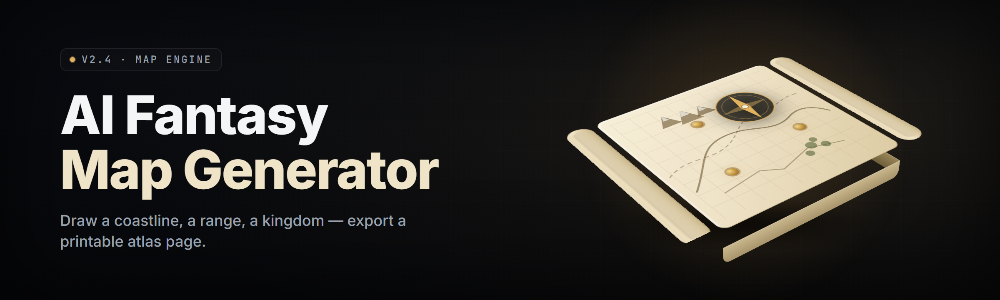

  
  
  

  

  
  
  

---

AI fantasy map generator for tabletop GMs and worldbuilders — type a region name and get a coherent hex or parchment map with rivers, biomes, and labels in one pass.

## Overview

AI fantasy map generator for tabletop GMs and worldbuilders — type a region name and get a coherent hex or parchment map with rivers, biomes, and labels in one pass.

  

## License

[MIT License](LICENSE)

  

